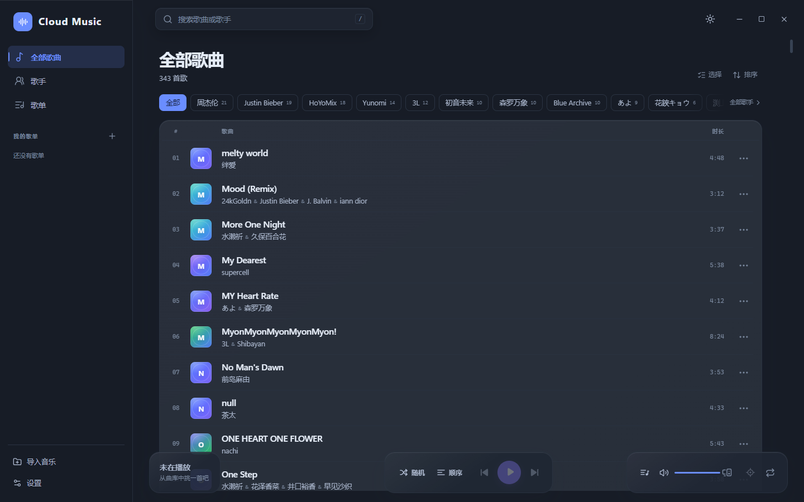
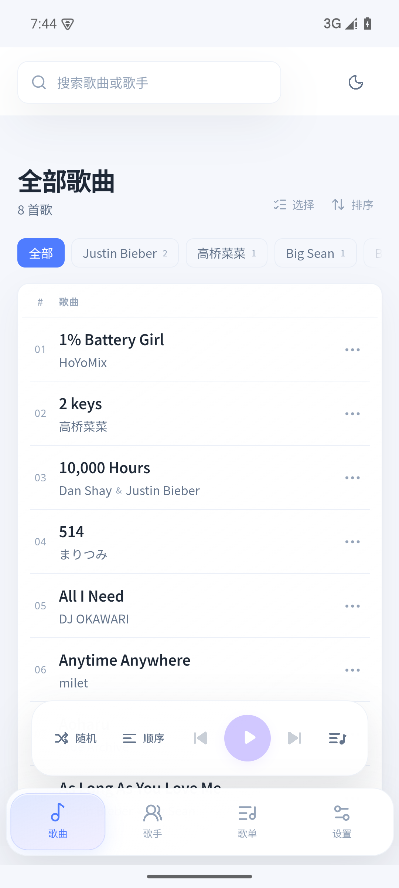
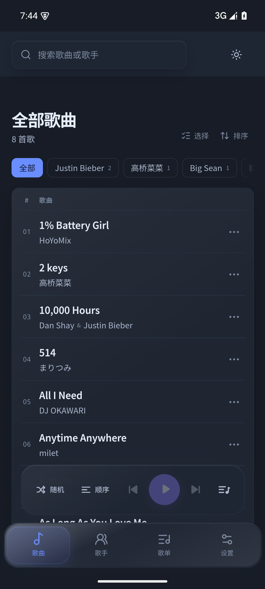

# Cloud Music

[中文](README.md) · [English](README.en.md) · v1.2.1

A calm, fully offline local music player. Track metadata comes from filenames; there are no lyrics and no online services.

The desktop app is built with **Electron + React + TypeScript**. Android is a **Capacitor WebView + native Java plugins**: the system file framework reads the library and MediaSession drives playback. Both platforms share the same UI, state, filename parser, and playback logic.



## Features

### Library and import

- Recursively scan a music folder, or drag audio files or folders into the window
- Parse the title and every participant from the filename: `Title—Artist 1&Artist 2&Artist 3.mp3`
- Large imports scan in the background and use an exact-match duplicate index instead of comparing every pair
- Duplicates are resolved one by one: keep the library copy, use the new file, or keep both when the title is shared but the artists differ
- Refresh the library: missing files move to “Invalid” and the records can be cleared without touching the files on disk
- Batch select, remove selected, or remove all; only the library entry is removed
- Imports, playlists, theme, and preferences stay on the device

### Browsing and organization

- Filter by artist; each artist page includes every collaboration
- Search by song or artist; sort by title, artist, or recently added, cycling with the “Sort” button
- Artist chips scroll horizontally and the selected chip moves to the front
- Create, rename, and delete playlists; add or remove tracks
- Turn the current selection into a new playlist
- A play-queue drawer; “+” on a track adds it to a playlist

### Playback

- Order and shuffle playback; repeat off, repeat all, or repeat one
- Play/pause, previous/next, seek, volume, and mute
- Click “Order” or “Shuffle” to restart from the currently visible list
- Locate the current track: scroll it to the center of the list and briefly highlight it
- Android native MediaSession: lock-screen card, notification, Bluetooth/headset buttons, and a foreground playback service
- On close, ask, minimize to the tray, or quit; the choice is remembered and can be changed in Settings
- The tray menu can restore the window or quit

### Interface

- Light/dark theme with a one-click toggle; follows the system on first launch
- Blue-violet accent, mint playing state, coral warning state; solid panels, restrained blur, no large glows
- No lyrics or online artwork; desktop list covers are generated from a title hash and show the first character
- FLIP animations for list reordering, honoring `prefers-reduced-motion`; a virtual list for large libraries
- The desktop player is split into three glass islands: track information, centered transport, and volume/locate/repeat
- Android uses one glass transport island (shuffle/order plus previous/play/next/queue) and a four-item glass navigation island; both slide away with the top bar on downward scroll and return on upward scroll
- The Android navigation island supports drag-to-select and glows while pressed
- Customizable keyboard shortcuts, stored locally

## Requirements

- Node.js 20 or newer
- No extra tooling for the Windows installer
- JDK 21, Android SDK Build-Tools 36, and Python 3 for the Android APK

## Quick start

```bash
npm install
npm run dev          # Vite + Electron development
```

Build and run with Electron:

```bash
npm run build
npm start
```

Run the tests (Vitest; filename parsing and duplicate detection):

```bash
npm test
```

To preview the UI in a browser only, run `npm run dev:web`. Browser mode has no native bridge; imported files use temporary object URLs and the library is empty after a refresh.

> If Electron downloads slowly, configure a mirror or place an existing
> `electron-v33.4.11-win32-x64.zip` in the Electron cache and retry.

## Scripts

| Command | Purpose |
| --- | --- |
| `npm run dev` | Development mode (Vite + Electron) |
| `npm run dev:web` | Preview the UI in a browser |
| `npm run build` | Type-check and build web assets into `dist/` |
| `npm start` | Load the built assets in Electron |
| `npm test` | Run the Vitest suite |
| `npm run dist` | Build and package the Windows NSIS installer into `release/` |
| `npm run apk` | Build web assets and re-sign the Android APK |
| `npm run verify:desktop` | Launch the packaged desktop app, check it over CDP, and capture a screenshot |
| `npm run cap:sync` | Build and sync web assets into `android/` (once the native project is restored) |

## Packaging and release

### Windows

```bash
npm run dist
```

Output:

```text
release/Cloud-Music-Setup-1.2.1.exe
release/win-unpacked/          # portable unpacked build, runs directly
```

The installer is NSIS, x64, per-user, allows choosing the install directory, and creates desktop and Start Menu shortcuts. It is not code-signed, so SmartScreen may warn on first launch; choose “More info → Run anyway”.

Optional self-check:

```bash
npm run verify:desktop
```

It starts `release/win-unpacked/Cloud Music.exe` with a debugging port, checks the window title, track rows, theme, and viewport, writes `shots/packaged-desktop.png`, and exits non-zero if the console reports errors.

### Android

> The Java sources of the `android/` project were lost in the 2026-10-30 cleanup incident (the current `android/` directory is an empty Capacitor scaffold), so the 1.2.1 APK is not a Gradle build. It keeps the native layer of the existing APK (SAF folder import, MediaSession foreground playback) and only replaces the bundled `assets/public` before re-signing.

Prepare JDK 21, Android SDK Build-Tools 36, and Python 3, then:

```powershell
$env:JAVA_HOME = "D:\Code\toolchain\jdk-21"
$env:ANDROID_HOME = "D:\Code\toolchain\android-sdk"
node scripts/apk.mjs
```

`node scripts/apk.mjs` builds the web assets first; add `--skip-build` to reuse an existing `dist/`. Output:

```text
release/Cloud-Music-Android-1.2.1-liquid.apk
```

The script takes the existing signed APK as the base package, replaces `assets/public`, strips the old signature files, zipaligns, and signs with `keys/cloudmusic-liquid-2026.jks` (v2 + v3), so versionCode, manifest, native plugins, and resources stay untouched. Use `--base <apk>` for another base package or `--out <apk>` for another destination.

Signing certificate SHA-256:

```text
49DAF5A5461FBF109F0B6CFA85DABB73194DEDBA28A92F473DF9761F4DB89CB7
```

> This APK uses a new signing key. If a build signed with the previous key is installed, uninstall it before installing this one.

Signing details, key location, and rebuild commands: [docs/ANDROID.md](docs/ANDROID.md). Full release notes: [docs/RELEASE.md](docs/RELEASE.md).

### Verifying the release artifacts

| Platform | File | Size | SHA-256 |
| --- | --- | ---: | --- |
| Windows x64 | `release/Cloud-Music-Setup-1.2.1.exe` | 94,390,117 B | `A8BDE58596EE5B939ACD9E53C70C2C3858096CC3FF3904BD94830C36CD896E45` |
| Android | `release/Cloud-Music-Android-1.2.1-liquid.apk` | 3,325,429 B | `94DE1B25FE6B89DE56FF1F8A9724B15D2E36A99EB3F8D86B3ACAFDA5B05228D8` |

The same values are recorded in `release/SHA256SUMS.txt`. The APK reports `versionCode` 4, `versionName` 1.2.1, `minSdk` 24, and `targetSdk` 36.

## Usage

1. On first launch, click “Import music” or “Import folder” and choose the directory that holds your music.
2. On desktop you can also drag audio files or folders into the window.
3. Click a track to play it; click an artist name to filter all tracks involving that artist.
4. Click “+” on a track to add it to a playlist or create a new one.
5. Click “Select” for batch selection; after filtering, select all visible tracks to remove them or create a playlist.
6. Toggle light/dark at the top right. “Settings” at the bottom left imports music, refreshes the library, edits shortcuts, and manages close behavior.
7. After closing, the tray menu can restore the window or quit.

Shortcuts (each can be changed in Settings; `Esc` always closes dialogs and the queue):

| Key | Action |
| --- | --- |
| `/` | Focus search |
| `Space` | Play/pause |
| `Ctrl + ←` / `Ctrl + →` | Previous/next |
| `↑` / `↓` | Volume up/down (5% steps) |
| `M` | Mute/unmute |
| `Ctrl + ,` | Open Settings |
| `Esc` | Close the queue or a dialog |

On desktop, combinations with Ctrl / Alt / Shift / Win keep working globally while the window is unfocused or minimized. Unmodified keys only work inside the app so they do not steal input from other applications.

## Filename rules

Supported extensions: `mp3`, `flac`, `m4a`, `aac`, `ogg`, `oga`, `opus`, `wav`, `webm`, `aiff`, `aif`, `wma`, `mka`, `m4b`.

```text
潮汐来信—海边的房间&林间电台.mp3
Paper Boat—June&Nova.flac
夜行列车—北纬三十度&陈默&林间电台.wav
```

- Standard form: `Title—Artist 1&Artist 2&Artist 3`, with no spaces around the em dash
- The last separator splits the title from the artists, so ordinary hyphens can stay in the title
- Legacy `-`, `–`, and `－` separators are accepted, as is the full-width `＆`
- Artists are separated by `&`; duplicates and blanks are removed
- A missing artist falls back to “Unknown Artist”

## Data and privacy

- The library, playlists, theme, sort order, and playback preferences live in local `localStorage` (`shiyin.library.v1`); shortcuts live in `cloudmusic.settings.v1`
- Close behavior is stored in `%APPDATA%\shiyin-player\window-prefs.json`
- No files are uploaded and no external APIs are called
- Desktop audio is served through a custom `aria-media://` protocol restricted to paths the user imported; HTTP Range is supported for seeking
- Android reads the selected directory through Storage Access Framework without copying audio. Access is persisted; missing files become “Invalid”
- Browser mode uses temporary object URLs, so the library is empty after a refresh by design

## Android notes

- Folder picker: `ACTION_OPEN_DOCUMENT_TREE` with persisted read permission
- Scanner: `DocumentsContract` with one `ContentResolver.query` per directory, not per file
- Playback: WebView `<audio>` plus a native `PlaybackService` that mirrors MediaSession, notification, and lock-screen controls
- Back button: close dialogs, the queue, or playlist detail first; exit last
- Status and navigation bar colors follow the theme; on Android 15 the system gesture strip may stay white in dark mode
- 1.2.1 was verified on an Android 15 (API 35) emulator: install, SAF import of 8 tracks, playback, `dumpsys media_session` reporting `state=PLAYING(3)`, and the foreground playback notification
- Architecture and permissions: [docs/ANDROID.md](docs/ANDROID.md)

| Android light | Android dark |
| --- | --- |
|  |  |

## Project layout

```text
electron/
  main.cjs          window, folder scan, aria-media Range protocol, tray, global shortcuts
  preload.cjs       window.shiyin native bridge
  demo-audio.cjs    demo audio for development
src/
  lib/              parser, player, store, duplicates, FLIP, virtual list, native bridges
  components/       sidebar, top bar, track list, player, queue, dialogs, settings
  views/            all tracks, artists, playlists, playlist detail
  styles.css        design tokens and responsive layout
scripts/
  dev.mjs           development mode
  start.mjs         production start
  dist.mjs          Windows packaging
  apk.mjs           Android APK asset replacement and re-signing
  patch-apk.py      APK asset replacement implementation
  verify-desktop.mjs packaged desktop self-check
  smoke.mjs         UI smoke check
android/            Capacitor Android scaffold (native Java sources pending recovery)
keys/               Android signing key and keystore.properties
build/icon.ico      installer icon
docs/               release notes, Android notes, screenshots
release/            release artifacts
```

## Known limitations

- Track metadata comes only from filenames; ID3/FLAC tags are not read
- No lyrics, artwork fetching, online search, or cloud sync
- The desktop layout targets wide screens and enforces a 1200 px minimum window width
- The Windows installer is unsigned, so SmartScreen may warn
- The Android release is self-signed; app-store distribution needs your own production signing key
- The Android native sources are missing; until they are restored, Gradle builds and AAB generation are not possible
- The Android 15 gesture navigation bar is drawn by the system and may not follow the dark theme
