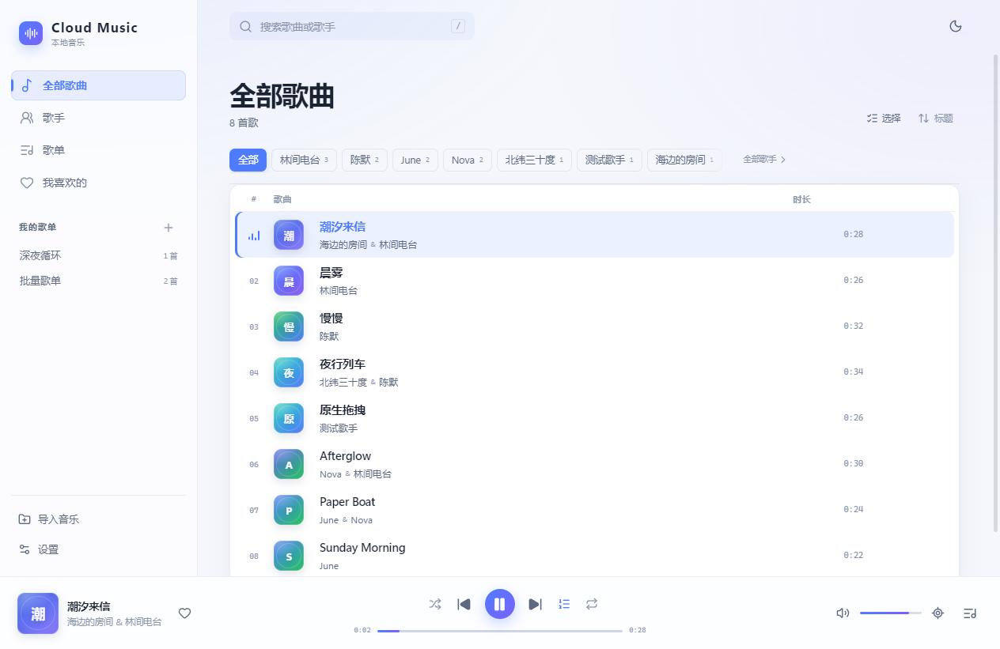
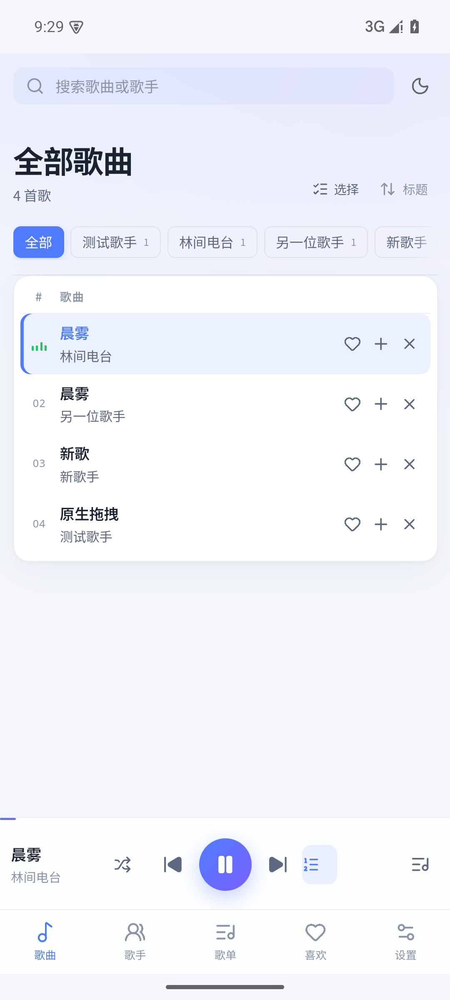
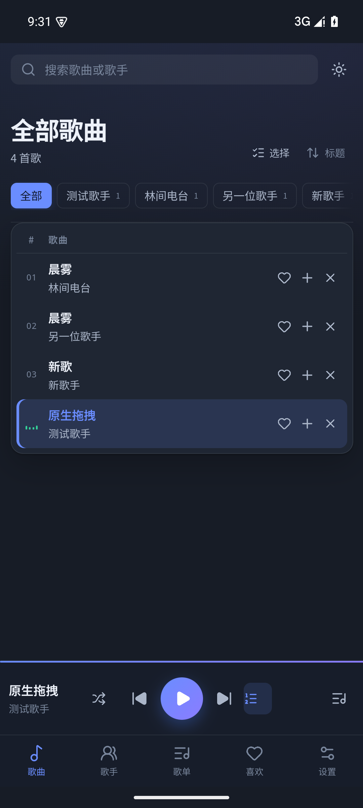

# Cloud Music

[中文](README.md) · [English](README.en.md)

A calm, fully offline local music player. The filename is the library metadata; there are no lyrics and no online services.

The desktop app uses **Electron + React + TypeScript**. Android uses **Capacitor + native Java plugins**. Both platforms share the same UI, state, filename parser, and playback logic.



## Features

### Library and import

- Recursively scan a music folder, or drag audio files/folders into the window
- Parse the title and every participant from the filename: `Title—Artist 1&Artist 2&Artist 3.mp3`
- Large imports use background scanning and an exact-match duplicate index instead of comparing every pair
- Duplicate dialog: keep the library copy, use the new file, or keep both when the title is shared but artists differ
- Refresh the library: missing files move to “Invalid” and can be cleared
- Batch select, remove selected, or remove all without deleting files from disk

### Browsing and organization

- Filter by artist; each artist page includes every collaboration
- Search and sort by title, artist, or date added
- Selected artist chips move to the front; the chip row scrolls horizontally
- Create, rename, and delete playlists; add or remove tracks
- Turn the current selection into a new playlist
- Liked tracks and a live play queue

### Playback

- Order, shuffle, repeat-one, and repeat-all modes
- Play/pause, previous/next, seek, volume, and mute
- Start the visible list in order or shuffle with one click
- Locate the current track; scroll it to the center and briefly highlight it
- System media controls: Windows MediaSession; Android native MediaSession, lock screen, notification, and Bluetooth/headset buttons
- On close, minimize to the tray or quit; the choice is remembered and can be changed in Settings

### Interface

- Light/dark theme with a one-click toggle; follows the system on first launch
- Blue-violet accent, mint playing state, coral warning state
- No lyrics or online artwork; covers are generated from a title hash and show the first character
- FLIP animations for list reordering; honors `prefers-reduced-motion`
- Bottom navigation below 860px; Android uses a taller player and hides the left artwork
- Customizable keyboard shortcuts, stored locally

## Quick start

Requires Node.js 20+.

```bash
npm install
npm run dev     # Vite + Electron development
```

Production build and start:

```bash
npm run build
npm start
```

Run tests:

```bash
npm test
```

> If Electron downloads slowly, configure a mirror or place an existing
> `electron-v33.4.11-win32-x64.zip` in the Electron cache and retry.

## Packaging

### Windows

```bash
npm run dist
```

Output: `release/Cloud-Music-Setup-1.1.0.exe`. The installer is not code-signed, so Windows SmartScreen may warn on first launch; choose “More info → Run anyway”.

### Android

Install Android SDK 36, Build Tools 36, and JDK 21, then:

```bash
npm run build
npx cap sync android
cd android
gradlew.bat assembleRelease bundleRelease
```

The project uses a local release keystore (path and passwords in `android/keystore.properties`, which is not committed). Outputs:

```text
android/app/build/outputs/apk/release/app-release.apk
android/app/build/outputs/bundle/release/app-release.aab
```

Release copies are in `release/Cloud-Music-Android-1.1.0-release.apk` and `release/Cloud-Music-Android-1.1.0-release.aab`. Signing and install notes: [docs/RELEASE.md](docs/RELEASE.md).

> If a debug build signed with another key is installed, uninstall it before installing the release APK.

## Usage

1. On first launch, click “Import folder” and choose the music directory.
2. You can also drag audio files or folders into the window. The desktop reads real paths; browser previews use temporary object URLs.
3. Click any track to play. Click an artist name to filter all tracks involving that artist.
4. Click “+” on a track to add it to a playlist or create one.
5. Click “Select” for batch selection; after filtering, select all visible tracks to remove or create a playlist.
6. Toggle light/dark at the top right. “Settings” at the bottom left imports music, refreshes the library, edits shortcuts, and manages close behavior.
7. After closing, the tray menu can restore the window or quit.

Shortcuts (editable in Settings):

| Key | Action |
| --- | --- |
| `/` | Focus search |
| `Space` | Play/pause |
| `Ctrl + ←` / `Ctrl + →` | Previous/next |
| `↑` / `↓` | Volume up/down |
| `M` | Mute/unmute |
| `Ctrl + ,` | Open Settings |
| `Esc` | Close queue or dialog |

## Filename rules

Supported extensions: `mp3`, `flac`, `m4a`, `aac`, `ogg`, `oga`, `opus`, `wav`, `webm`, `aiff`, `aif`, `wma`, `mka`, `m4b`.

```text
潮汐来信—海边的房间&林间电台.mp3
Paper Boat—June&Nova.flac
夜行列车—北纬三十度&陈默&林间电台.wav
```

- Standard form: `Title—Artist 1&Artist 2&Artist 3`, with no spaces around the em dash.
- The last separator splits title from artists, so ordinary hyphens can remain in the title.
- Legacy `-`, `–`, and `－` separators are accepted, as is the full-width `＆`.
- Artists are separated by `&`; duplicates and blanks are removed.
- A missing artist falls back to “Unknown Artist”.

## Data and privacy

- The library, playlists, likes, theme, and playback preferences live in local `localStorage`.
- Close behavior is stored in `%APPDATA%\shiyin-player\window-prefs.json`.
- No files are uploaded and no external APIs are called.
- Desktop audio is served through a custom `aria-media://` protocol restricted to paths the user imported; HTTP Range is supported for seeking.
- Android reads the selected directory through Storage Access Framework without copying audio. Access is persisted; missing files become “Invalid”.
- Browser mode uses temporary object URLs, so the library is empty after refresh by design.

## Android notes

- Folder picker: `ACTION_OPEN_DOCUMENT_TREE` with persisted read permission.
- Scanner: `DocumentsContract` with one `ContentResolver.query` per directory, not per file.
- Playback: WebView `<audio>` plus a native `PlaybackService` that mirrors MediaSession, notification, and lock-screen controls.
- Back button: close dialogs/queue/playlist detail first; exit last.
- Status/navigation bar colors follow the theme. On Android 15 the system gesture strip may remain white in dark mode.
- Architecture and permissions: [docs/ANDROID.md](docs/ANDROID.md).

| Android light | Android dark |
| --- | --- |
|  |  |

## Project layout

```text
electron/
  main.cjs          window, folder scan, aria-media Range protocol, tray, capture hook
  preload.cjs       window.shiyin native bridge
src/
  lib/              parser, player, store, duplicates, FLIP, virtual list, bridges
  components/       sidebar, top bar, track list, player, queue, dialogs
  views/            all tracks, artists, playlists, playlist detail, liked
  styles.css        design tokens and responsive layout
android/            Capacitor Android project
  app/src/main/java/com/shiyin/player/
                    ShiyinLibraryPlugin, ShiyinPlaybackPlugin, PlaybackService
scripts/            development, packaging, and test scripts
docs/               Android notes, release notes, screenshots
```

## Known limitations

- Track metadata comes only from filenames; ID3/FLAC tags are not read.
- No lyrics, artwork fetching, online search, or cloud sync.
- The Android release is self-signed; app-store distribution needs your own production signing key.
- The Windows installer is unsigned, so SmartScreen may warn.
- The Android 15 gesture navigation bar is drawn by the system and may not follow the dark theme.
