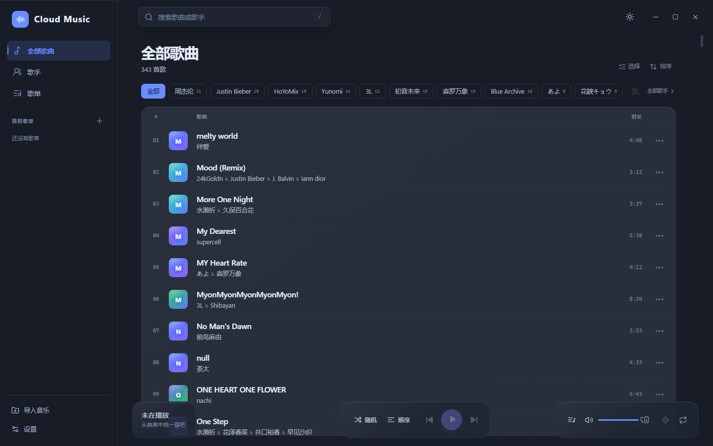
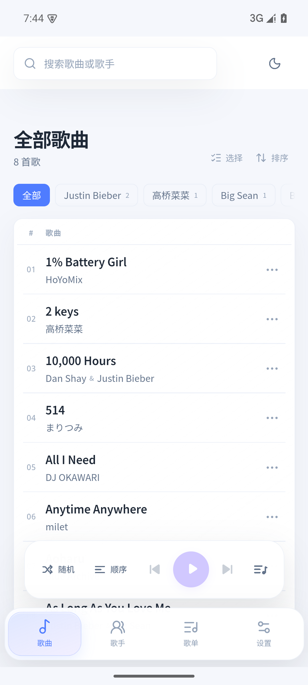
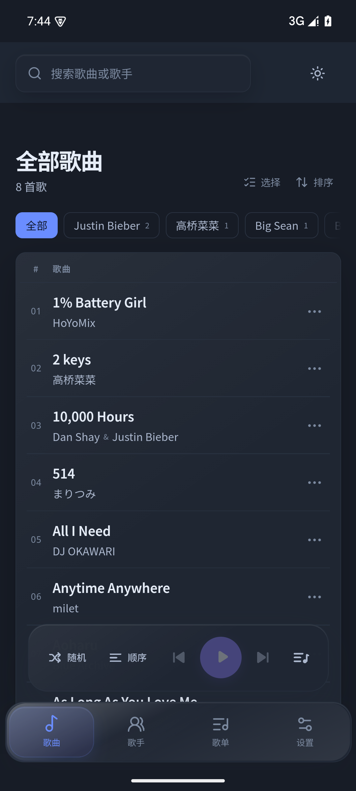

# Cloud Music

[中文](README.md) · [English](README.en.md) · v1.2.1

一个干净、克制的本地音乐播放器。曲目信息来自文件名，不显示歌词，也不做任何在线服务。

桌面端使用 **Electron + React + TypeScript**；Android 端是 **Capacitor WebView + 原生 Java 插件**，用系统文件框架读取音乐、用 MediaSession 控制播放。两端共享同一套界面、状态、文件名解析和播放逻辑。



## 功能

### 曲库与导入

- 递归扫描音乐文件夹；也可以把音频文件或文件夹直接拖进窗口
- 按文件名解析曲名和全部参与者：`歌曲名—歌手1&歌手2&歌手3.mp3`
- 大曲库导入在后台扫描，并使用精确去重索引，避免两两比对
- 导入重复歌曲时逐首询问：保留曲库版本、使用新文件，或同名不同歌手时两首都保留
- 刷新曲库：文件丢失的歌曲进入「已失效」，可一键清空记录（不删除本地文件）
- 批量选择、批量移除、全部移除；只移出曲库
- 导入记录、歌单、主题和偏好都保存在本机

### 浏览与整理

- 按歌手筛选；歌手页包含该歌手的全部合作曲目
- 搜索歌曲或歌手；按标题、歌手、最近添加排序，点「排序」循环切换
- 歌手标签横向拖动，选中的标签自动移到最前
- 歌单创建、重命名、删除，添加或移除歌曲
- 筛选后可把选中的歌曲直接建成新歌单
- 播放队列抽屉，点击歌曲右侧「+」可加入歌单

### 播放

- 顺序播放、随机播放；循环关闭、列表循环、单曲循环
- 播放 / 暂停、上一首 / 下一首、拖动进度、音量 / 静音
- 点当前列表的「顺序」或「随机」，从当前可见列表重新开始播放
- 定位当前播放歌曲：滚动到列表中央并短暂高亮
- Android 原生 MediaSession：锁屏卡片、通知栏、蓝牙 / 耳机按键、前台播放服务
- 关闭窗口时可选择每次询问、最小化到系统托盘或直接退出，选择会记住并可在设置中修改
- 系统托盘菜单可重新显示窗口或退出

### 界面

- 亮色 / 暗色主题，右上角一键切换，首次启动跟随系统
- 蓝紫主色、薄荷绿播放态、珊瑚红警示态；实色面板、克制的模糊，没有大面积光斑
- 没有歌词和在线封面；桌面列表封面由曲名哈希生成渐变和首字
- 列表重排使用 FLIP 动画，尊重 `prefers-reduced-motion`；大曲库使用虚拟列表
- 桌面播放器分成三个玻璃岛：歌曲信息、居中控制、音量 / 定位 / 循环
- Android 底部是一个控制玻璃岛（随机 / 顺序 + 上一首 / 播放 / 下一首 / 队列）和一个四项导航岛；向下滚动时顶栏与两个岛一起收起，向上滚动时回来
- Android 导航岛支持拖动选择；按下时有辉光反馈
- 快捷键可自定义，设置保存在本机

## 环境要求

- Node.js 20 或更高版本
- 打包 Windows 安装包不需要额外工具
- 打包 Android 额外需要 JDK 21、Android SDK Build-Tools 36、Python 3

## 快速开始

```bash
npm install
npm run dev          # Vite + Electron 开发模式
```

生产构建并以 Electron 启动：

```bash
npm run build
npm start
```

运行测试（Vitest，文件名解析与去重逻辑）：

```bash
npm test
```

只想在浏览器里看界面：`npm run dev:web`。浏览器模式没有原生桥，导入的文件使用临时 object URL，刷新后曲库为空。

> 如果 Electron 下载缓慢，可先配置镜像，或把已有的
> `electron-v33.4.11-win32-x64.zip` 放进 Electron 缓存目录后重试。

## 常用脚本

| 命令 | 作用 |
| --- | --- |
| `npm run dev` | 开发模式（Vite + Electron） |
| `npm run dev:web` | 只在浏览器中预览界面 |
| `npm run build` | 类型检查并构建 Web 资源到 `dist/` |
| `npm start` | 用 Electron 加载已构建的资源 |
| `npm test` | 运行 Vitest 测试 |
| `npm run dist` | 构建并打包 Windows NSIS 安装包到 `release/` |
| `npm run apk` | 构建 Web 资源并重新签名 Android APK |
| `npm run verify:desktop` | 启动打包后的桌面端，用 CDP 检查界面并截图 |
| `npm run cap:sync` | 构建后同步 Web 资源到 `android/`（原生工程恢复后使用） |

## 打包与发布

### Windows

```bash
npm run dist
```

输出：

```text
release/Cloud-Music-Setup-1.2.1.exe
release/win-unpacked/          # 免安装版本，可直接运行
```

安装包是 NSIS、x64、按用户安装，可选择安装目录，并创建桌面和开始菜单快捷方式。安装包未做代码签名，首次运行时 SmartScreen 可能提示，选择「更多信息 → 仍要运行」即可。

可选的自检：

```bash
npm run verify:desktop
```

它会以调试端口启动 `release/win-unpacked/Cloud Music.exe`，检查窗口标题、歌曲行、主题和视口，并把截图写到 `shots/packaged-desktop.png`；控制台出现错误时以非零码退出。

### Android

> `android/` 原生工程在 2026-10-30 的清理事故中丢失了 Java 源码（当前的 `android/` 只是空壳脚手架），所以 1.2.1 的 APK 不是 Gradle 构建的。它保留既有 APK 的原生层（SAF 文件夹导入、MediaSession 前台播放），只替换包内的 `assets/public` 并重新签名。

准备 JDK 21、Android SDK Build-Tools 36、Python 3，然后：

```powershell
$env:JAVA_HOME = "D:\Code\toolchain\jdk-21"
$env:ANDROID_HOME = "D:\Code\toolchain\android-sdk"
node scripts/apk.mjs
```

`node scripts/apk.mjs` 会先构建 Web 资源；已经有 `dist/` 时可加 `--skip-build` 跳过。输出：

```text
release/Cloud-Music-Android-1.2.1-liquid.apk
```

脚本以现有的已签名 APK 为底包，替换 `assets/public`、去掉旧签名文件、`zipalign` 对齐，再用 `keys/cloudmusic-liquid-2026.jks` 签名（v2 + v3），因此 versionCode、清单、原生插件和资源都不会变化。可用 `--base <apk>` 换底包，`--out <apk>` 换输出位置。

当前签名证书 SHA-256：

```text
49DAF5A5461FBF109F0B6CFA85DABB73194DEDBA28A92F473DF9761F4DB89CB7
```

> 这个 APK 使用了新的签名密钥。设备上装过旧签名的 Cloud Music 时，需要先卸载旧包再安装。

签名细节、密钥位置和重建命令见 [docs/ANDROID.md](docs/ANDROID.md)；完整发布说明见 [docs/RELEASE.md](docs/RELEASE.md)。

### 发布产物校验

| 平台 | 文件 | 大小 | SHA-256 |
| --- | --- | ---: | --- |
| Windows x64 | `release/Cloud-Music-Setup-1.2.1.exe` | 94,390,117 B | `A8BDE58596EE5B939ACD9E53C70C2C3858096CC3FF3904BD94830C36CD896E45` |
| Android | `release/Cloud-Music-Android-1.2.1-liquid.apk` | 3,325,429 B | `94DE1B25FE6B89DE56FF1F8A9724B15D2E36A99EB3F8D86B3ACAFDA5B05228D8` |

同样的值记录在 `release/SHA256SUMS.txt`。APK 的 `versionCode` 为 4，`versionName` 为 1.2.1，`minSdk` 24，`targetSdk` 36。

## 使用

1. 首次打开点击「导入音乐」或「导入文件夹」，选择存放音乐的目录。
2. 桌面端也可以把音频文件或文件夹直接拖进窗口。
3. 点击任意歌曲开始播放；点击歌手名筛选该歌手的全部歌曲。
4. 点击歌曲右侧的「+」加入歌单或新建歌单。
5. 点击「选择」进入批量选择；筛选后全选当前，可批量移除或建成新歌单。
6. 右上角切换亮色 / 暗色主题；左下角「设置」可导入音乐、刷新曲库、修改快捷键和关闭窗口行为。
7. 关闭窗口后可在设置里选择最小化到托盘；托盘菜单可以重新显示窗口或退出。

快捷键（可在设置中逐项修改，`Esc` 固定用于关闭弹窗和队列）：

| 按键 | 行为 |
| --- | --- |
| `/` | 聚焦搜索框 |
| `Space` | 播放 / 暂停 |
| `Ctrl + ←` / `Ctrl + →` | 上一首 / 下一首 |
| `↑` / `↓` | 音量 + / -（每次 5%） |
| `M` | 静音 / 取消静音 |
| `Ctrl + ,` | 打开设置 |
| `Esc` | 关闭队列或弹窗 |

桌面端带 Ctrl / Alt / Shift / Win 的组合键在窗口失焦或最小化时仍然全局生效；无修饰键的按键只在应用内生效，避免抢占其他应用的输入。

## 文件命名规则

支持的扩展名：`mp3`、`flac`、`m4a`、`aac`、`ogg`、`oga`、`opus`、`wav`、`webm`、`aiff`、`aif`、`wma`、`mka`、`m4b`。

```text
潮汐来信—海边的房间&林间电台.mp3
Paper Boat—June&Nova.flac
夜行列车—北纬三十度&陈默&林间电台.wav
```

- 标准格式：`歌曲名—歌手1&歌手2&歌手3`，破折号两侧不加空格
- 最后一个分隔符是曲名与歌手的分界，所以曲名里可以保留普通连字符
- 同时兼容旧格式的 `-`、`–`、`－` 分隔符，以及全角 `＆`
- 参与者用 `&` 分隔，自动去重、去空白
- 找不到歌手时归入「未知艺术家」

## 数据与隐私

- 曲库、歌单、主题、排序和播放偏好保存在本机 `localStorage`（`shiyin.library.v1`）；快捷键保存在 `cloudmusic.settings.v1`
- 关闭窗口行为保存在 `%APPDATA%\shiyin-player\window-prefs.json`
- 不上传任何文件，不请求外部接口
- 桌面端通过自定义 `aria-media://` 协议读取本地音频，只允许访问用户导入过的路径，并支持 HTTP Range 拖动进度
- Android 通过 Storage Access Framework 直接读取用户选中的目录，不复制音乐文件；授权持久化，原目录失效时歌曲进入「已失效」
- 浏览器模式使用临时 object URL，刷新后曲库为空，这是刻意设计

## Android 说明

- 目录选择：`ACTION_OPEN_DOCUMENT_TREE` + 持久化读权限
- 扫描：`DocumentsContract`，每个目录一次 `ContentResolver.query`，不逐文件查询
- 播放：WebView `<audio>` 播放，原生 `PlaybackService` 同步 MediaSession、通知栏和锁屏控制
- 返回键：优先关闭弹窗 / 队列 / 歌单详情，最后才退出
- 状态栏 / 导航栏颜色随主题切换；Android 15 的系统手势条由系统绘制，深色下可能保持白色
- 1.2.1 已在 Android 15（API 35）模拟器上验证：安装、SAF 导入 8 首歌、播放、`dumpsys media_session` 显示 `state=PLAYING(3)`、前台播放通知正常
- 详细架构与权限见 [docs/ANDROID.md](docs/ANDROID.md)

| Android 亮色 | Android 暗色 |
| --- | --- |
|  |  |

## 项目结构

```text
electron/
  main.cjs          窗口、文件夹扫描、aria-media Range 协议、托盘、全局快捷键
  preload.cjs       window.shiyin 原生桥
  demo-audio.cjs    开发演示音频
src/
  lib/              解析、播放器、状态、去重、FLIP、虚拟列表、原生桥
  components/       侧栏、顶栏、歌曲列表、播放条、队列、弹窗、设置
  views/            全部歌曲、歌手、歌单、歌单详情
  styles.css        设计令牌与响应式布局
scripts/
  dev.mjs           开发模式
  start.mjs         生产模式启动
  dist.mjs          Windows 打包
  apk.mjs           Android APK 替换资源并重新签名
  patch-apk.py      APK 资源替换实现
  verify-desktop.mjs 打包后桌面端自检
  smoke.mjs         界面冒烟检查
android/            Capacitor Android 脚手架（原生 Java 源码待恢复）
keys/               Android 签名密钥与 keystore.properties
build/icon.ico      安装包图标
docs/               发布说明、Android 说明与截图
release/            发布产物
```

## 已知边界

- 曲目信息只来自文件名，不读取 ID3 / FLAC 元数据
- 没有歌词、封面抓取、在线搜索或云同步
- 桌面端布局按宽屏设计，窗口有 1200 px 最小宽度
- Windows 安装包未签名，SmartScreen 可能提示
- Android 使用本地自签名证书；上架应用商店需要换成正式签名
- Android 原生工程源码缺失，恢复前无法用 Gradle 构建，也无法生成 AAB
- Android 15 手势导航条由系统绘制，深色主题下不随应用变色
